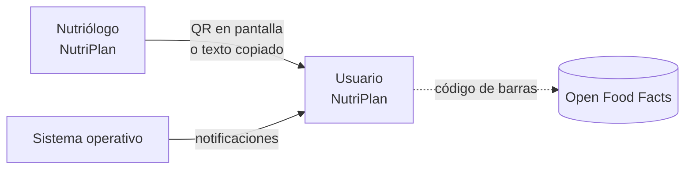
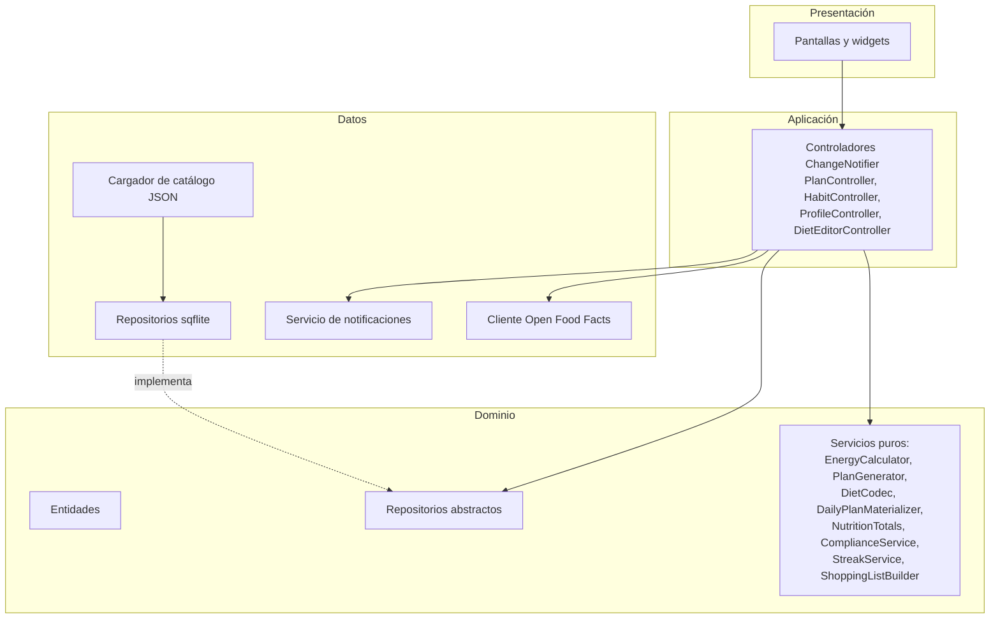
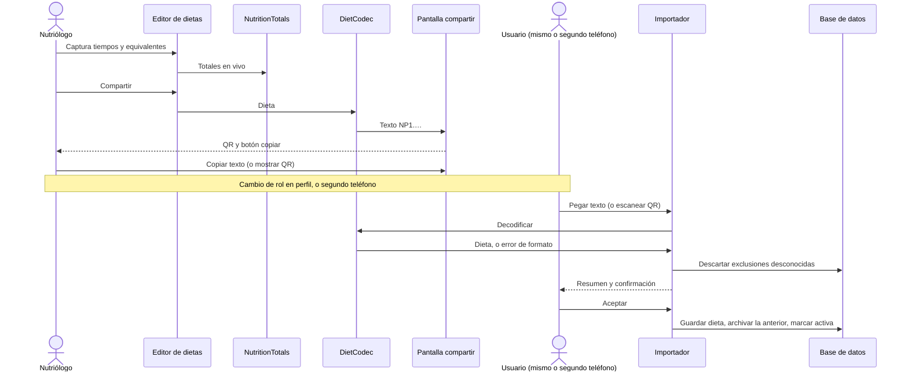
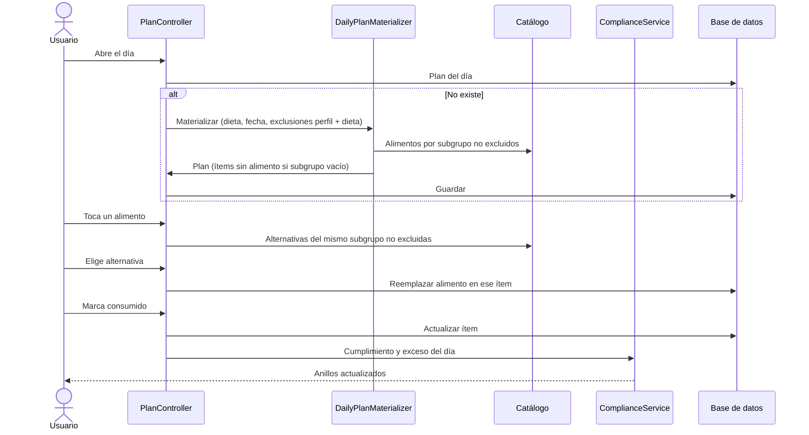
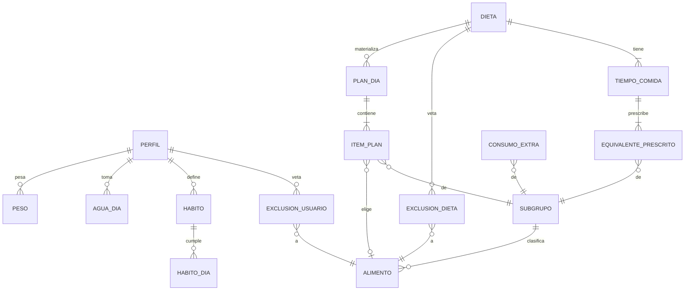

# NutriPlan: Diseño de Alto Nivel (HLD)

| Campo | Valor |
|---|---|
| Versión | 1.6 |
| Fecha | 2026-10-04 |
| Documento previo | `02-investigacion-tecnica.md` |
| Documento siguiente | `04-lld.md` |

## 1. Propósito

Este documento describe qué componentes forman NutriPlan, qué hace cada uno y por qué se diseñó así. No entra en clases ni esquemas de tablas; eso está en el LLD. Un lector debe terminar sabiendo cómo fluye una dieta desde que el nutriólogo la captura hasta que el usuario marca su cena como consumida, y qué decisiones sostienen ese flujo.

## 2. Contexto del sistema

NutriPlan corre completa en el teléfono. No tiene servidor propio. Sus únicos contactos con el exterior son la API pública de Open Food Facts, consultada solo al escanear o capturar un código de barras, y el sistema operativo, que entrega notificaciones programadas. El intercambio de dietas entre nutriólogo y paciente ocurre por un texto codificado que viaja como código QR en pantalla o como texto copiado y enviado por cualquier mensajería.



Esta forma responde a las restricciones del proyecto: no hay presupuesto para backend, la demostración debe funcionar sin red y en un solo dispositivo si hace falta, y la consulta nutricional en México es presencial, así que nutriólogo y paciente suelen estar juntos al compartir el plan.

## 3. Modelo conceptual

Todo el diseño gira alrededor de cuatro conceptos. Entenderlos evita confundir lo que prescribe el nutriólogo con lo que elige el usuario.

**Subgrupo.** Una categoría del SMAE con valor nutricional fijo por equivalente. "Cereales sin grasa" vale 70 kcal, 2 g de proteína y 15 g de carbohidratos, sin importar qué cereal sea.

**Alimento.** Un producto concreto del catálogo que pertenece a un subgrupo e indica cuánto es un equivalente en medida casera: una tortilla, media taza de arroz. Lleva etiquetas de alérgenos. Todos los alimentos de un subgrupo son intercambiables uno a uno.

**Dieta.** Lo que prescribe el nutriólogo o genera la app: para cada tiempo de comida, cuántos equivalentes de cada subgrupo, más una lista de alimentos excluidos. La dieta no menciona alimentos concretos; es la estructura, no el contenido.

**Plan del día.** Lo que el usuario ve y come: para cada equivalente prescrito, un alimento concreto. El usuario puede cambiar el alimento cuantas veces quiera; la dieta no cambia. Al marcar consumido, se registra contra el subgrupo, así el cumplimiento se mide en los términos que el nutriólogo prescribió.

Separar dieta de plan del día es lo que hace posible el intercambio con un toque sin tocar la prescripción, y lo que mantiene pequeño el texto compartido: solo viaja la dieta.

Un quinto concepto atraviesa a los demás: **exclusiones**. El usuario declara en su perfil los alimentos que no consume (alergias, intolerancias, preferencias), y el nutriólogo puede agregar exclusiones a una dieta. La unión de ambas se aplica siempre que se elige o se ofrece un alimento.

## 4. Arquitectura

La aplicación se divide en cuatro capas con dependencias en una sola dirección. Dominio no depende de nada.



La razón es doble. Primero, la lógica que da valor (cumplimiento, generación de plan, codificación de dieta, totales del editor) vive en el dominio como Dart puro que se prueba sin simulador. Segundo, los dos autores avanzan en paralelo: uno sobre dominio y datos, otro sobre presentación contra repositorios en memoria.

Los controladores son `ChangeNotifier` del SDK, uno por área funcional, creados al arrancar con sus repositorios y pasados por constructor a las pantallas. No hay paquete de manejo de estado. El cliente de Open Food Facts y el servicio de notificaciones son servicios de infraestructura que los controladores usan directamente a través de una interfaz mínima; no son repositorios de dominio porque no persisten entidades.

## 5. Componentes

### 5.1 Catálogo de alimentos

Carga el JSON de assets a la base de datos en el primer arranque y expone búsqueda por nombre, filtro por subgrupo y consulta de alternativas excluyendo una lista de IDs. Es la única fuente de alimentos. Se carga a SQLite y no se lee del JSON directamente porque las consultas de intercambio requieren índices y porque los alimentos del usuario deben convivir con los del catálogo.

Cubre RF-2.1, RF-2.2, RF-2.3, RF-2.4; RNF-11.

### 5.2 Editor de dietas

Pantallas y lógica del rol nutriólogo. Permite crear una dieta, definir tiempos de comida, asignar equivalentes por subgrupo y marcar exclusiones. El servicio `NutritionTotals` calcula en vivo kcal y macronutrientes del día sumando los promedios por subgrupo, y su porcentaje contra la meta. Las plantillas por kcal son dietas precargadas que se copian al crear. El editor no conoce alimentos concretos.

Cubre RF-3.1 a RF-3.7.

### 5.3 Compartir e importar

Convierte una dieta en texto codificado y de regreso. El codificador serializa la dieta a JSON con claves cortas, comprime con gzip y codifica en base64url con un prefijo de versión. El resultado se muestra como QR y como texto copiable. El decodificador valida prefijo, versión y estructura, descarta exclusiones que refieran alimentos inexistentes en el dispositivo receptor, marca la dieta con origen "importada" para distinguirla de las que el propio dispositivo creó, y la entrega lista para guardar.

Se eligió texto codificado sobre un servidor porque elimina cuentas, red y costo, y porque la dieta cabe: el límite de diseño es 800 caracteres, legible como QR desde una pantalla de teléfono. La ruta por texto pegado es obligatoria porque el simulador de desarrollo no tiene cámara y porque permite demostrar el flujo completo en un solo dispositivo.

Cubre RF-4.1 a RF-4.8.

### 5.4 Generador de plan

Produce una dieta para el usuario sin nutriólogo pasando por filtros de seguridad antes de calcular: edad desde la fecha de nacimiento (menor de 18 o 65 o más detiene; esta comprobación corre al abrir la pantalla, antes de mostrar el cuestionario), cuestionario de exclusión, control por IMC, y comprobación de que exista un déficit posible (si el piso de kcal iguala o supera el gasto total y el objetivo es bajar, detiene). Después calcula el gasto energético con Mifflin-St Jeor, lo ajusta por actividad y objetivo con tope de déficit del 25 %, aplica el piso por sexo y elige la plantilla más cercana a la meta entre las que respetan ese tope, comparando kcal reales y admitiendo la misma tolerancia de 5 % sobre el piso con que se aceptan las plantillas. Si el objetivo es bajar y la plantilla elegida no deja al menos un 5 % de déficit, detiene y sugiere el objetivo mantener; con objetivo mantener o subir, una meta por encima de 3200 kcal no tiene plantilla. En un empate entre dos plantillas se elige la menor al bajar y la mayor en otro caso. Cada plantilla trae su reparto por tiempo de comida escrito a mano y verificado, así que el generador copia el reparto en vez de calcularlo: un algoritmo de reparto automático se probó en la ronda 1 de auditoría y producía colaciones vacías. Antes de guardar, el caso de uso que orquesta la generación verifica con el catálogo que cada subgrupo prescrito tenga al menos un alimento no excluido; si alguno queda vacío, detiene e informa cuál.

El resultado es una dieta idéntica en forma a la de un nutriólogo, así que todo lo que sigue funciona igual sin importar el origen. Es un motor de reglas y no un modelo de lenguaje porque debe ser determinista, auditable y gratuito. El aviso legal se muestra y se acepta en cada generación.

Cubre RF-5.1 a RF-5.7, RF-5.9; RNF-7.

### 5.5 Plan del día y semana

Toma la dieta activa y, para cada día, materializa un plan: por cada equivalente prescrito elige un alimento del subgrupo que no esté excluido, con generador aleatorio sembrado por fecha y un contador de regeneración, y lo presenta en medida casera. Si un subgrupo queda sin alimentos por las exclusiones (posible en cualquier dieta si el usuario amplía sus exclusiones después de activarla), el ítem se muestra sin alimento y el usuario lo elige a mano. El usuario puede cambiar cualquier alimento por otro del mismo subgrupo, marcarlo consumido o regenerar los ítems no consumidos del día; si la prescripción cambió desde la última materialización, los ítems consumidos se conservan y la diferencia se agrega como ítems nuevos.

La materialización se hace bajo demanda al abrir un día y no por adelantado para toda la semana, porque un cambio de dieta a mitad de semana debe reflejarse en los días que aún no se han abierto sin invalidar los ya abiertos. Al editar la dieta activa, los planes de días futuros ya materializados se descartan para que se vuelvan a generar con la prescripción nueva; el de hoy y los pasados se conservan.

Cubre RF-6.1 a RF-6.7; RF-5.8.

### 5.6 Registro de hábitos y agua

Hábitos definidos por el usuario con días de la semana en que aplican, marcados por día. El agua es un contador diario contra una meta. Ambos alimentan las rachas. Se mantienen separados del plan porque no dependen de la dieta.

Cubre RF-7.1 a RF-7.4.

### 5.7 Motor de cumplimiento y progreso

Servicio de dominio que, dado el consumo de un día y la dieta activa, calcula tres cosas: el cumplimiento por subgrupo (consumido contra prescrito, recortado a 100 %), el cumplimiento global ponderado por equivalentes prescritos, y el exceso (todo lo consumido por encima de lo prescrito, incluyendo subgrupos que la dieta no prescribe, en equivalentes y kcal estimadas). Separar cumplimiento de exceso evita que comer el doble se vea como 100 % sin más, y evita que un postre registrado desaparezca porque la dieta no tenía azúcares.

Cubre RF-8.1 a RF-8.4. Las extensiones opcionales RF-8.5 a RF-8.7 (celebración, compartir logro, alerta de pérdida de peso) se construyen sobre este mismo servicio y el historial de peso del perfil.

### 5.8 Lista de compras

Recorre los planes materializados de la semana, suma por alimento y agrupa por grupo. Conserva artículos manuales y el estado comprado al regenerar.

Cubre RF-9.1, RF-9.2.

### 5.9 Escáner de código de barras (opcional)

Lee el código con la cámara o lo recibe escrito a mano, consulta Open Food Facts, propone el subgrupo más cercano por perfil de macronutrientes y permite guardar el producto como alimento personalizado. Guarda cada producto consultado. Es el único componente que usa red y degrada a captura manual cuando no la hay. Es prioridad C: se construye solo si los obligatorios cierran antes de la semana 8.

Cubre RF-2.5, RF-2.6.

### 5.10 Notificaciones (opcional)

Programa recordatorios diarios de agua (horas fijas, máximo 12) y de comidas (uno por tiempo con hora). Los recordatorios de hábitos quedan fuera de 1.0. Usa alarmas inexactas en Android y mantiene 18 pendientes como máximo, lejos del límite de 64 de iOS. Antes de pedir el permiso muestra para qué se usará y funciona sin él. Prioridad C.

Cubre RF-10.1 a RF-10.3.

### 5.11 Perfil y ajustes

Datos del usuario incluyendo peso, rol, exclusiones personales (alimentos y alérgenos), tema, meta de agua, acceso al aviso legal y a los ajustes de notificaciones. Al cambiar de rol a usuario, si faltan datos de perfil, se reutiliza el formulario del registro. El peso se registra con fecha para el historial. El perfil vive en SQLite junto con el resto del dominio; shared_preferences guarda solo el tema y el flag de onboarding.

Cubre RF-1.1 a RF-1.7; RNF-7.

## 6. Flujos principales

### 6.1 El nutriólogo comparte una dieta (demo en un solo dispositivo)



### 6.2 El usuario sin nutriólogo genera su plan

```mermaid
sequenceDiagram
    actor U as Usuario
    participant UC as GeneratePlanUseCase
    participant X as Cuestionario
    participant G as PlanGenerator
    participant CAT as Catálogo
    participant L as Aviso legal
    participant DB as Base de datos

    U->>UC: Abre Generar (perfil completo)
    UC->>G: checkAge
    alt Edad < 18 o >= 65
        G-->>U: No se genera; acudir con nutriólogo
    else
        U->>X: Responde cuestionario
        alt Alguna afirmativa
            X-->>U: No se genera; acudir con nutriólogo
        else
            X->>UC: Respuestas negativas
            UC->>G: generate
            G->>G: IMC; bloquea <18.5 con bajar o >=40; avisa <18.5 con otro objetivo
            G->>G: Mifflin-St Jeor, GET, piso; bloquea si bajar y piso >= GET
            G->>G: Meta con tope 25 %; candidatas por kcal reales >= max(0.95 piso, 0.75 GET)
            alt Sin candidatas, o mantener/subir con meta > 3200
                G-->>U: No hay plantilla; acudir con nutriólogo
            else Bajar y kcal reales de la elegida >= 95 % del GET
                G-->>U: No hay déficit seguro; sugiere mantener
            else
                G->>UC: Dieta (reparto fijo de la plantilla)
                UC->>CAT: ¿Cada subgrupo tiene alimento no excluido?
                alt Algún subgrupo vacío
                    UC-->>U: No se genera; indica el subgrupo
                else
                    UC->>L: Dieta generada
                    L-->>U: Aviso legal
                    U->>L: Acepta
                    L->>DB: Guardar con origen automático, marcar activa
                end
            end
        end
    end
```

### 6.3 El usuario cambia un alimento y lo marca consumido



## 7. Datos

Los datos viven en SQLite (sqflite), incluido el perfil del usuario. El catálogo se carga desde assets en el primer arranque. shared_preferences guarda solo el tema y el flag de onboarding. Nada sale del dispositivo salvo el código de barras a Open Food Facts.



`ITEM_PLAN` puede no tener alimento (RF-6.7). `CONSUMO_EXTRA` se asocia por fecha, no por plan, para que sobreviva a una regeneración del día. `PERFIL` es una tabla de una sola fila. El detalle de columnas, índices y migraciones está en el LLD.

## 8. Decisiones de diseño y alternativas

| Decisión | Alternativa descartada | Razón |
|---|---|---|
| Dieta separada del plan del día | Alimentos dentro de la dieta | El intercambio modificaría la prescripción; el texto compartido crecería |
| Texto codificado (QR y copiable) | Firebase, Supabase, deep links | Sin costo ni cuentas; funciona sin red y en un solo dispositivo; los esquemas propios no son tocables en mensajería |
| Motor de reglas con filtros de seguridad | Modelo de lenguaje | Determinista, auditable, gratuito, verificable por un nutriólogo |
| Reparto por tiempo fijo en cada plantilla | Algoritmo de reparto por porcentajes | El algoritmo, trazado a mano, dejaba colaciones vacías y comidas sin leguminosa; 7 repartos escritos y probados son más simples y correctos |
| Catálogo en SQLite desde JSON | Leer el JSON en cada consulta | Búsqueda indexada; convivencia con alimentos del usuario |
| Materialización bajo demanda | Semana completa al activar | Cambio de dieta a mitad de semana sin invalidar días abiertos |
| Consumo por subgrupo, exceso aparte | Consumo por alimento | El cumplimiento se mide como prescribe el nutriólogo; el exceso no se esconde |
| Exclusiones en perfil y en dieta | Solo en dieta | El usuario sin nutriólogo también tiene alergias |
| Dos roles en una sola app | Dos apps | Una base de código, una demo |
| ChangeNotifier y Navigator del SDK | Riverpod y go_router | Sin paquetes externos de estado ni navegación; coincide con lo visto en clase |

## 9. Atributos de calidad

**Operación sin red.** Todo lo obligatorio funciona sin conexión. Solo Open Food Facts usa red y cae a captura manual.

**Rendimiento.** La pantalla de inicio lee el plan del día y el consumo con dos consultas indexadas. El cumplimiento se calcula en memoria sobre decenas de registros. La búsqueda de catálogo usa un índice por subgrupo y nombre.

**Mantenibilidad.** El dominio no depende de Flutter ni de sqflite. El esquema se versiona con `onUpgrade` desde la versión 1. Las entidades son inmutables.

**Privacidad.** Sin telemetría ni cuentas. Las respuestas del cuestionario no se guardan; solo la aceptación del aviso legal con fecha.

**Seguridad del plan automático.** Seis barreras en serie: edad calculada del perfil, cuestionario de exclusión, control por IMC, comprobación de déficit posible, piso con tope de déficit y selección de plantilla acotada, y aviso legal por generación. Las exclusiones del perfil impiden proponer alimentos a los que el usuario es alérgico, y la generación se detiene si algún subgrupo queda sin opciones en lugar de entregar un plan con huecos de proteína.

**Compatibilidad con el entorno de desarrollo.** Toda función M se puede desarrollar y demostrar en el simulador de iOS, que no tiene cámara. Las funciones de cámara son S y se prueban en iPhone físico.

## 10. Extensiones previstas

- **Sincronización remota.** Una implementación adicional del repositorio de dietas que lea de un servicio en la nube. El codec se reutiliza como formato de intercambio.
- **Reconocimiento por foto.** Un componente que sugiera un alimento del catálogo a partir de una imagen y lo entregue al flujo de "registrar alimento fuera del plan".
- **Platillos compuestos.** Alimentos que se descomponen en varios equivalentes. El consumo por subgrupo ya lo soporta.
- **Enlaces profundos.** Si se consigue un dominio https, Universal Links y App Links permitirían abrir el texto codificado desde mensajería.
